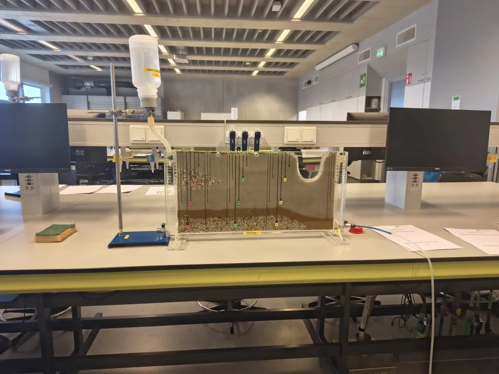
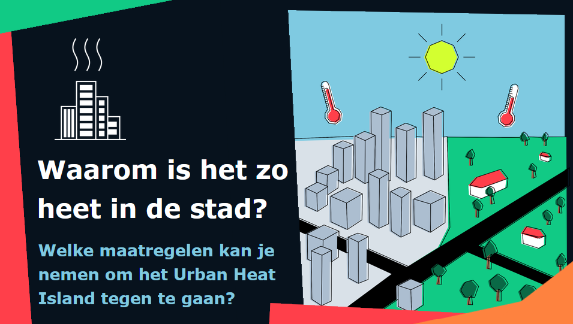
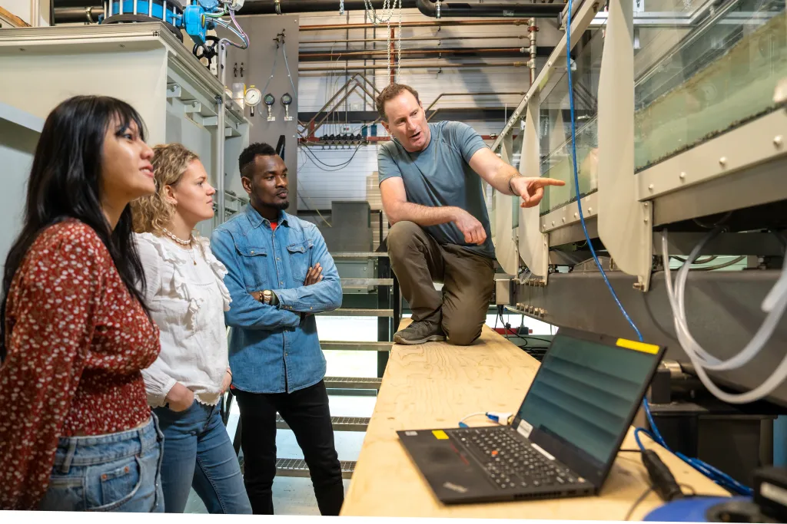

# Voor middelbareschooldocenten

Wageningen Universiteit biedt studiemateriaal en activiteiten voor middelbareschooldocenten. Samen met [Wageningen pre-university](https://www.wur.nl/nl/onderwijs/pre-university/voor-middelbare-scholieren) hebben we de volgende dingen ontwikkeld die voorbereiden op [Earth System Sciences](http://www.wur.nl/bsw).

## Mobiel practicum

Dit is een practicum waarin leerlingen zelf met schaalmodellen de stroming en kwaliteit van grondwater onderzoeken. Voor dit practicum kun je nu met de klas naar Wageningen komen, en binnenkort kan het practicum naar je school toekomen. Het wordt begeleid door Wageningse studenten.

- [Practicum: Ontdek de verborgen wereld van ons grondwater](https://www.wur.nl/nl/onderwijs/pre-university/practicum-ontdek-de-verborgen-wereld-van-ons-grondwater)

 

## Lesmodules voor in de klas

Deze digitale lesmodules kun je zelf gebruiken op school.
- Lesmodule [Heeft de regenworm het gedaan?](https://www.lessonup.com/en/channel/4tuschools/lesson/mWRwY7qvSB6AxxSkf)
- Lesmodule [Waarom is het zo heet in de stad?](https://www.lessonup.com/nl/lesson/4LL8YsTqGDZDZB2Yp) 
- Lessnack [Hoe heet is jouw stad?](https://www.wur.nl/nl/onderwijs/pre-university/voor-docenten/lesmateriaal/lessnack-hoe-heet-jouw-stad)
- NLT-lesmodule, eventueel te combineren met een bezoek aan Wageningen [Summer in the City](https://www.wur.nl/nl/onderwijs/pre-university/voor-docenten/lesmodules/summer-city)
- `Junior consultancy training' project, eventueel te combineren met een bezoek aan Wageningen [Casus stad van de toekomst](https://www.wur.nl/nl/onderwijs/pre-university/voor-docenten/activiteiten-voor-leerlingen/casus-stad-van-de-toekomst)
- Lesmateriaal [NL2120: toolkit voor een hoopvolle, duurzame toekomst](https://www.wur.nl/nl/onderwijs/pre-university/voor-docenten/lesmateriaal/open-leermaterialen-nederland-2120)
<!-- - Lesmodule [Stikstof: Wat is het probleem?](https://www.lessonup.com/en/channel/4tuschools/lesson/BgagqNBMFLsPjtWtN) --->

 

## Docentendagen

Kom zelf naar Wageningen voor interessante nascholingsactiviteiten.
- [Docentendag Turbulente tijden: de natuurkunde achter rivieren en wolken](https://www.wur.nl/nl/activiteit/docentendag-turbulente-tijden-de-natuurkunde-achter-rivieren-en-wolken)
- [Docentendag Aardrijkskunde en biologie: Van klimaatuitdagingen naar natuurinclusieve oplossingen](https://www.wur.nl/nl/activiteit/docentendag-aardrijkskunde-en-biologie-van-klimaatuitdagingen-naar-natuurinclusieve-oplossingen)

 

